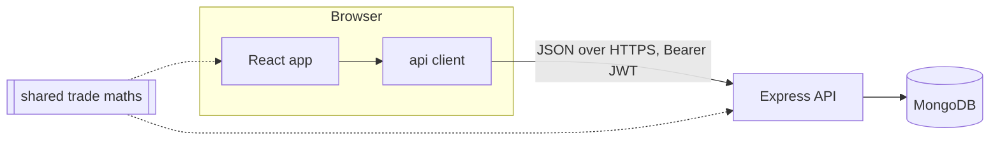

# TradeLog

A full stack MERN trading journal. Log every trade, see your risk per position, your equity curve and which setups actually make money.

**Live demo:** [usman1905.github.io/tradelog](https://usman1905.github.io/tradelog/)

[](https://github.com/usman1905/tradelog/actions/workflows/ci.yml)
[](https://github.com/usman1905/tradelog/actions/workflows/deploy.yml)

> The public demo runs in demo mode: the React app uses an in-browser data store so anyone can try it without an account. Point it at the API (below) and it switches to real accounts and MongoDB storage.

## Features

- Accounts with email and password (bcrypt hashing, JWT sessions)
- Add, edit, delete and search trades; filter by date range, side and result
- Live risk, P&L and R-multiple preview while you type a trade
- Dashboard: net P&L, win rate, average R, profit factor, max drawdown
- Equity curve and R distribution charts (Canvas, no chart library)
- Performance by setup, to see which strategies pay
- CSV export
- New accounts can start with a sample month of trades

## Tech stack

| Layer | Tools |
| --- | --- |
| Client | React 19, React Router 7, Vite |
| API | Node.js, Express 5, Zod validation, Helmet, CORS, rate limiting |
| Database | MongoDB with Mongoose |
| Auth | JWT, bcrypt |
| Testing | Node test runner + Supertest (API), Vitest + Testing Library (client) |
| Tooling | npm workspaces, ESLint, GitHub Actions CI, GitHub Pages deploy, Docker Compose, Render blueprint |

## Architecture



The trade maths (P&L, R-multiple, drawdown, stats) lives in one shared package used by both the client and the API, so the numbers always agree. Validation rules are shared too: the form and the API reject the same trades.

```
tradelog/
├── client/          React app (Vite)
│   ├── src/api/     HTTP client and in-browser demo store, same interface
│   ├── src/context/ Auth and toast state
│   ├── src/pages/   Dashboard, Trades, Login
│   └── tests/       Vitest + Testing Library
├── server/          Express API
│   ├── src/models/  Mongoose models: User, Trade
│   ├── src/routes/  /api/auth, /api/trades
│   ├── src/middleware/ JWT auth, validation, error handling
│   └── tests/       Supertest against a real MongoDB
└── shared/          Trade maths used by both sides
```

## API

All trade routes need `Authorization: Bearer <token>` and only ever return the signed-in user's data.

| Method | Path | Description |
| --- | --- | --- |
| POST | `/api/auth/register` | Create an account. Returns `{ token, user }` |
| POST | `/api/auth/login` | Sign in. Returns `{ token, user }` |
| GET | `/api/auth/me` | Current user |
| GET | `/api/trades` | List trades. Query: `from`, `to`, `side`, `result`, `q`, `page`, `limit` |
| GET | `/api/trades/summary` | Stats, results by setup and equity curve |
| GET | `/api/trades/export.csv` | All trades as CSV |
| POST | `/api/trades` | Create a trade |
| GET | `/api/trades/:id` | One trade |
| PUT | `/api/trades/:id` | Update a trade |
| DELETE | `/api/trades/:id` | Delete a trade |
| GET | `/api/health` | Health check |

Errors always come back as `{ "error": "message" }` with the right status code (400, 401, 404, 409).

## Run locally

Needs Node.js 20+ and MongoDB (local, Docker or Atlas).

```bash
npm install
cp server/.env.example server/.env      # set MONGODB_URI and JWT_SECRET
cp client/.env.example client/.env      # VITE_API_URL=http://localhost:4000
npm run dev                             # API on :4000, app on :5173
```

Or start MongoDB and the API with Docker, then run the client:

```bash
docker compose up
npm run dev:client
```

Leave `VITE_API_URL` empty to run the client on its own in demo mode.

## Tests

```bash
npm test         # shared maths, API and client
npm run lint
```

The API tests run against a real MongoDB: set `MONGODB_URI_TEST`, or they start an in-memory MongoDB automatically. CI runs everything against a MongoDB 8 service container on every push.

## Deploy

- **Client:** every push to `main` builds the app and publishes it to GitHub Pages (`.github/workflows/deploy.yml`).
- **API:** `render.yaml` deploys the server to Render's free tier. Create a free MongoDB Atlas cluster, add its connection string as `MONGODB_URI` on Render, then set the repository variable `VITE_API_URL` to the Render URL and re-run the deploy workflow. The live app then uses real accounts.

## License

MIT. Built by [Muhammad Usman Shabbir](https://usman1905.github.io).
